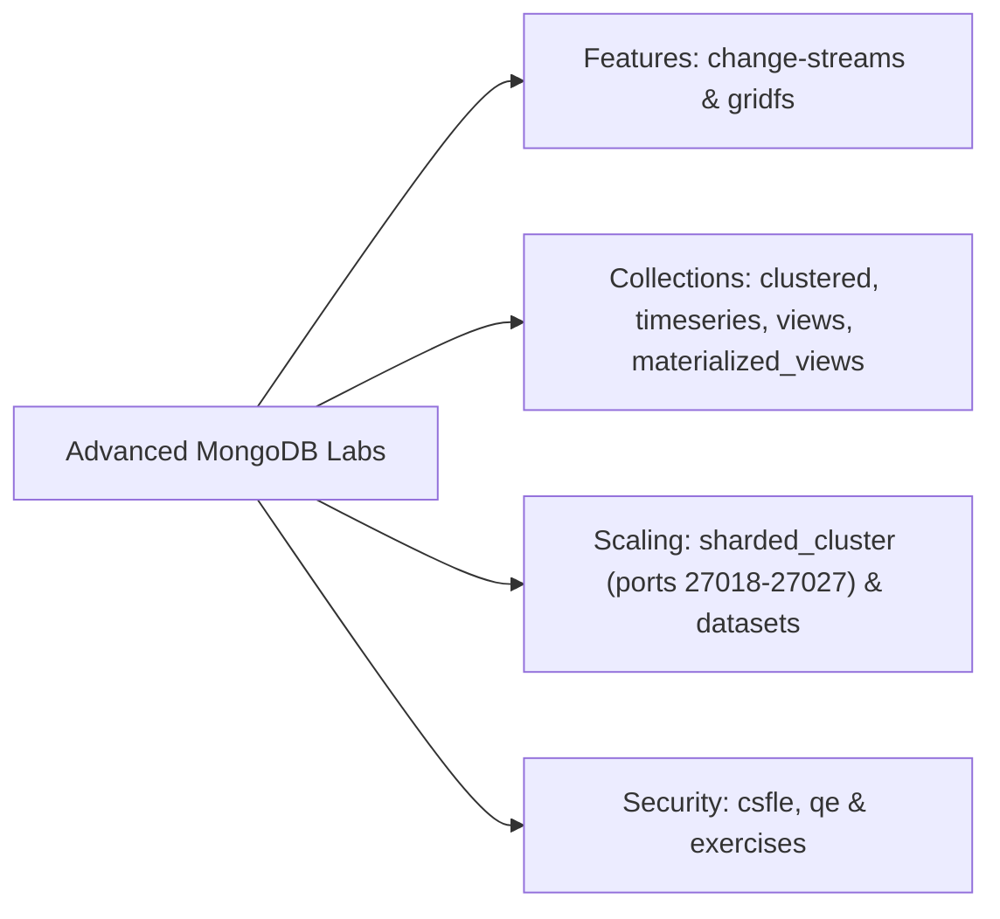

# Advanced MongoDB
This is the repository for the LinkedIn Learning course Advanced MongoDB. The full course is available from [LinkedIn Learning][lil-course-url].

![Advanced MongoDB][lil-thumbnail-url] 

Expand on what you learned in MongoDB Essential Training by exploring advanced features and concepts within this powerful document database. Instructor Naomi Pentrel divides the course into four standalone sections. To begin, Naomi covers advanced features, such as change streams and GridFS. She then dives into advanced collection types and indexes that can help you use MongoDB more efficiently; how to scale your deployment using sharding; and how to use client-side field-level encryption to encrypt sensitive data before it even leaves the client. After wrapping up this course, you’ll have the information you need to start getting more value from your database.

## Instructions
_See the readme file in the main branch for updated instructions and information._

This repository has folders for each of the videos in the course that requires a lot of typing.

Browse the full English [Diátaxis documentation](docs/index.md) for tutorials, ASD-STE100 operational runbooks, cluster/module references, and architecture notes.

## Course Modules Overview



| Directory | Topic | Key Files |
| :--- | :--- | :--- |
| `change-streams/` | Watch operations & resume-token recovery | `main.py`, `change_stream.py`, `change_stream_2.py`, `resumable_change_stream.py` |
| `clustered_collections/` | Clustered `_id` collections | `create_clustered_collection.js` |
| `csfle/` | Explicit Client-Side Field Level Encryption | `main.py`, `script`, `requirements.txt` |
| `qe/` | Queryable Encryption with equality queries | `main.py`, `script`, `requirements.txt` |
| `exercises/` | Course challenge solutions | `exercise_1_5.py`, `exercise_4_4.py`, `script` |
| `gridfs/` | Binary storage (`> 16 MB`) with GridFS | `main.py`, `20MB_file`, `requirements.txt` |
| `materialized_views/` | On-demand `$merge` views | `create_view.js`, `data_change.js`, `update_view.js` |
| `timeseries/` | Time-series stock price collections | `create_timeseries_collection.js`, `add_stock_data.js`, `sample_query.js` |
| `views/` | Standard read-only aggregation view | `sample_query.js` |
| `sharded_cluster/` | 9-node sharded lab (`27018–27027`) | `mongos.conf`, `cfgsrv1-3.conf`, `m1-6.conf`, `script`–`script6` |
| `datasets/` | Sample JSON datasets & `mongoimport` script | `books.json`, `filme.json`, `orders.json`, `stocks.json`, `script` |

## Verification

Run the automated Python test suite offline (no running MongoDB cluster required):

```bash
python -B -m unittest discover -s tests -p "test_*.py" -v
```


### Instructor

Naomi Pentrel 
                            
Software Engineer 

                            

Check out my other courses on [LinkedIn Learning](https://www.linkedin.com/learning/instructors/naomi-pentrel).

[lil-course-url]: https://www.linkedin.com/learning/advanced-mongodb
[lil-thumbnail-url]: https://cdn.lynda.com/course/2476236/2476236-1661449045299-16x9.jpg
