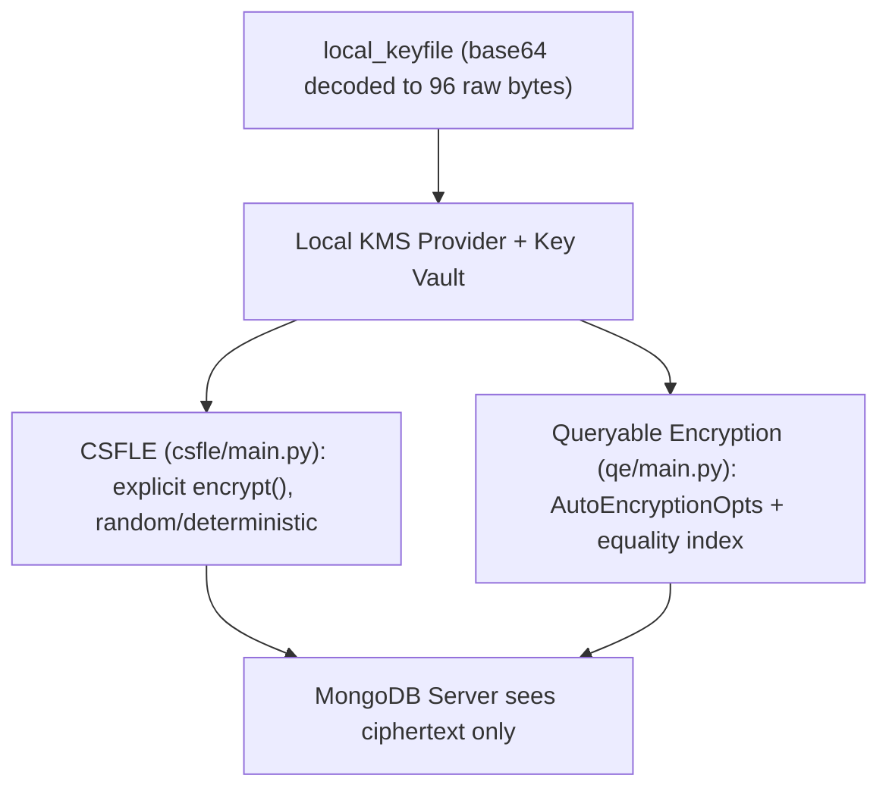

# CSFLE vs Queryable Encryption and Change Streams

This repository demonstrates two MongoDB encryption patterns alongside event-driven change streams backed by oplog resume tokens.

## Encryption Architecture Trade-Offs

- **Explicit CSFLE (`csfle/main.py`, `exercises/exercise_4_4.py`):** Sets `bypass_auto_encryption=True`, creates named data encryption keys (`key_alt_names`), and explicitly calls `client_encryption.encrypt(...)`. Randomized encryption protects identical values with distinct ciphertexts (no equality queries), whereas deterministic encryption (`exercise_4_4.py` on `email`) enables equality lookups at the cost of leaking value equality in ciphertext.
- **Queryable Encryption (`qe/main.py`):** Uses `encrypted_fields_map` and `create_encrypted_collection(...)` so equality queries on `credit_card.number` evaluate over encrypted metadata structures (`queries: [{"queryType": "equality"}]`) while keeping plaintext out of server memory.
- **Why `load_local_master_key` decodes base64:** The helper shell scripts write base64 output via `echo $(head -c 96 /dev/urandom | base64 | tr -d '\n') > local_keyfile`. Decoding whitespace-stripped base64 back into exact 96 raw `bytes` satisfies PyMongo's strict master key length contract.

## Iterative Change Stream Recovery (`resumable_change_stream.py`)

Change streams track oplog cursors via `stream.resume_token`. Unbounded recursive retries risk hitting Python's recursion limit during prolonged primary elections or network partitions; iterating with `while True` and passing `resume_after=resume_token` with capped backoff (`min(sleep * 2, 60)`) keeps memory flat while resuming cleanly after transient `PyMongoError` events.
