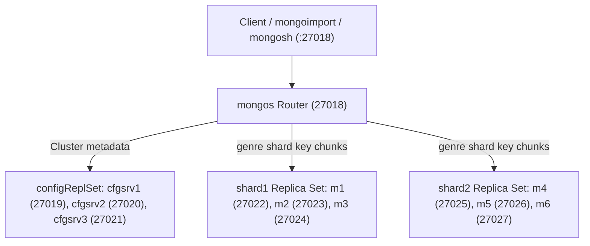

# Sharded Topology, Views, and Time-Series Design

The scaling and storage labs compare distributed sharding, on-disk clustered storage, and read-time versus materialized aggregations.

## Sharded Cluster Topology

Routing `test.filme` on shard key `{genre: 1}` splits queries by chunk ranges stored on `configReplSet`, isolating each shard behind its own replica set for failover (`3` members per replica set). Note that `sharded_cluster/keyfile` is strictly a public course fixture and must never be reused outside localhost labs.

## Collections, Views, and Materialization Trade-Offs

- **Clustered Collections (`clustered_collections/`):** Orders documents physically by `{ _id: 1 }` in a single B-tree (`clusteredIndex`), eliminating secondary `_id` index lookups for sequential `_id` access.
- **Standard vs Materialized Views (`views/` vs `materialized_views/`):** `views/sample_query.js` executes `$project` and `$group` live on every read with zero extra storage, whereas `materialized_views/create_view.js` and `update_view.js` pre-compute `stocksDailyAvgView` using `$merge` (`replace` / `insert`), trading write/refresh orchestration for faster reads.
- **Time-Series Collections (`timeseries/`):** Groups hourly measurements (`granularity: "hours"`) by metadata key `ticker` and timestamp `ts` into columnar buckets for compressed storage and efficient range scans.
